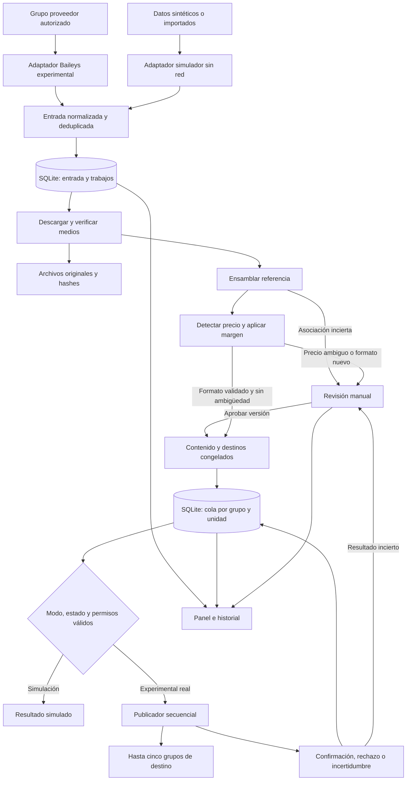

# Bot Distribuidor de Tenis — Plan técnico

**Fecha:** 12 de octubre de 2026.

**Estado:** plan aprobado; se implementan sesiones múltiples, perfiles por proveedor, catálogo de entrada, revisión de precios, fotografía marcada y envío manual individual o masivo. El envío permanece apagado de forma predeterminada y requiere activación local y confirmación del operador.
**Plataforma inicial:** computador local Windows 11 o macOS, un operador y varias sesiones independientes de WhatsApp.
**Carga prevista:** 20–60 referencias diarias, varios grupos proveedor por cuenta y hasta cinco grupos destino compartidos por los proveedores de cada cuenta.
**Moneda y presentación:** pesos colombianos enteros; interfaz en español; zona horaria `America/Bogota`.

## Estado de implementación

| Parte | Estado |
| --- | --- |
| Monorepo TypeScript, aplicación React y API local limitada a loopback | Implementado en el prototipo. |
| SQLite local con migración versionada, checksum, productos, fotos, auditoría, configuración y simulaciones | Implementado; la migración v8 conserva la instalación de una cuenta y crea el perfil “Cuenta principal”. |
| Catálogo de publicaciones y fotos recibidas desde el grupo proveedor, conservación de bytes, detección de importes y margen COP | Implementado; productos ambiguos requieren revisión antes de enviarse. El catálogo no solicita agregar productos manualmente. |
| Etiquetas locales de hasta cinco grupos, revisión, cola simulada e historial por grupo | Implementado; se mantiene separado de los JID reales de WhatsApp. |
| Baileys 6.7.24 estable, conexión QR y consulta/selección de grupos | Implementado detrás de un adaptador y un registro de conectores por cuenta. Habilitado en macOS y Windows con modo `experimental` y `WHATSAPP_ENABLED=true`. |
| Credenciales cifradas | AES-256-GCM con registros por sesión; clave maestra en Llavero de macOS o protegida con DPAPI CurrentUser en Windows. La primera vinculación de cada cuenta real queda por validar en el equipo del operador. |
| Recepción programada y recuperación reciente por cuenta | Ventana diaria editable por cuenta (09:00–21:00 `America/Bogota` inicialmente), bandeja persistente fuera del horario, liberación cronológica, recuperación reciente de Baileys limitada a 24 horas y filtrada por proveedor activo. El catálogo persiste entre reinicios y la recuperación se muestra como intento parcial, nunca como garantía. |
| Agrupación de fotos y descripción por referencia | El flujo nuevo crea un producto por fotografía. Caption en la misma imagen queda asociado. Un mensaje de texto cercano solo se adjunta si hay una única foto compatible del mismo remitente; cuando compiten varias fotos no se adivina y el producto/texto requiere revisión. |
| Precio, margen y código | Reglas explícitas por proveedor con márgenes independientes para PRECIO y CAJA (ambos desde $0), parser determinista para `$`, `💲`, COP, miles y k; reemplaza cada importe según su etiqueta y conserva el texto restante. Los renglones independientes de precio por DOCENA se omiten de la descripción publicada sin modificar el original recibido. Proveedores que ya incluyan la ganancia configuran $0 en ambos campos. En el texto, se extraen códigos con prefijos COD/CÓDIGO/REF/SKU, respetando ceros iniciales; como formato adicional acordado, se aceptan códigos numéricos `NNN-NN` y `NNN-NNN` inmediatamente después de HOMBRE/MUJER/DAMA/CABALLERO cuando no haya un código explícito con prefijo. Códigos contradictorios requieren revisión; `MUJER 40-44` y “RETRO 40” no producen código. El OCR local opcional puede sugerir códigos de la foto, pero requiere selección manual; nunca reconoce ni modifica precios de la imagen. |
| Marca sobre copia local de la fotografía | Sharp genera una copia desde el original, con orientación EXIF aplicada, código/emoji del proveedor, esquina predeterminada o ajustada por producto y vista previa. Original inmutable; fuente y gráficos Twemoji se incluyen con atribuciones. |
| Cola persistente y salida por destino | Una publicación por cuenta/producto/destino; fija caption y archivo derivado al crearla. El operador envía una referencia o confirma lote de cuenta/filtro actual; precios ambiguos no se envían. Prueba con grupos propios sigue pendiente. |
| Recuperación de publicaciones inciertas | Las transmisiones interrumpidas pasan a revisión y no se reintentan solas; el sistema no promete entrega exactamente una vez. Conciliación manual completa y control detallado de cada unidad siguen pendientes. |
| Paquete y validación local | Pendiente de validar en el Mac del operador y en Windows 11; CI incluye ambos, pero no sustituye una prueba de instalación y piloto en el computador destino. |

La aprobación del plan autorizó implementar el alcance y subirlo a un repositorio privado. La automatización real continúa siendo experimental, requiere habilitación explícita y validación del operador.

## Resumen de la decisión

Construir un monolito modular local en Node.js y TypeScript, con panel React, API local y procesamiento orientado a eventos persistidos en SQLite. Las imágenes se guardarán como archivos locales. Baileys quedará detrás de un adaptador experimental reemplazable. No se necesitan Redis, microservicios, nube, servicios pagos ni modelos de IA.

El sistema prepara referencias cuya asociación de foto y precio es suficientemente explícita; lo ambiguo queda en revisión. La salida conserva el texto y cambia exclusivamente los importes aprobados. Cada proveedor tiene márgenes independientes para PRECIO y CAJA, ambos desde **$0 COP**, con accesos de $0, $5.000 y $10.000. Los importes identificados con cada etiqueta usan su regla propia.

Hay dos límites que deben quedar visibles desde el principio:

1. Baileys no convierte la automatización en una actividad autorizada por WhatsApp. Existe riesgo de suspensión, cambios incompatibles e interrupciones; trabajar con grupos propios y autorizados no elimina ese riesgo.
2. No se puede prometer entrega externa exactamente una vez. Si el proveedor acepta un envío y el equipo falla antes de persistir la confirmación, el resultado es incierto. El sistema no lo reenviará automáticamente: solicitará reconciliación.

## 0. Investigación previa y alcance verificable

### 0.1 Hallazgos en fuentes primarias

| Hallazgo comprobado | Consecuencia de arquitectura | Fuente |
| --- | --- | --- |
| Los términos de WhatsApp restringen comunicaciones no permitidas, incluida mensajería masiva y automática, y contemplan suspensión de cuentas. | Integración experimental explícita; mantener una alternativa de publicación manual. | [Términos de WhatsApp](https://www.whatsapp.com/legal/terms-of-service?channel=null&lang=en) |
| El centro de ayuda advierte que mensajes automáticos o masivos pueden causar bloqueos y que intervienen reportes de usuarios. | No afirmar que cierto volumen, intervalo o consentimiento evita restricciones. | [Uso responsable de WhatsApp](https://faq.whatsapp.com/361005896189245/?eea=0&locale=en_US) |
| Baileys usa WhatsApp Web, no está afiliado ni autorizado por WhatsApp; su repositorio desaconseja mensajería automática o masiva y anuncia cambios incompatibles en v7. | Aislarlo, fijar versiones y validar cada actualización antes de usarla. | [Repositorio oficial de Baileys](https://github.com/WhiskeySockets/Baileys) |
| `messages.upsert` contiene un arreglo y puede incluir sincronización offline o mensajes en tiempo real. `notify` y `append` no son una frontera suficiente para toda la lógica del negocio. | Recorrer todos los mensajes; persistir y deduplicar antes de decidir qué procesar. | [Recepción de actualizaciones](https://github.com/WhiskeySockets/baileys.wiki-site/blob/main/docs/socket/receiving-updates.md) |
| La conexión emite QR y cambios de credenciales; la documentación desaconseja `useMultiFileAuthState` para producción. | Implementar almacenamiento transaccional protegido de credenciales y claves, no copiar el ejemplo de archivos sin protección. | [Conexión y autenticación](https://github.com/WhiskeySockets/baileys.wiki-site/blob/main/docs/socket/connecting.md) |
| La migración v7 incorpora identificadores LID y categorías adicionales de claves de autenticación. | Tratar identificadores como opacos; no usar el teléfono como identidad obligatoria ni asumir un esquema fijo de claves. | [Migración v7](https://github.com/WhiskeySockets/baileys.wiki-site/blob/main/docs/migration/to-v7.0.0.md) |
| El esquema del repositorio contiene `albumMessage`, conteos esperados y asociaciones `MEDIA_ALBUM` con padre e índice. | Aprovechar relaciones explícitas cuando lleguen; su presencia en el esquema no garantiza soporte completo de recepción o envío. | [Esquema WAProto](https://raw.githubusercontent.com/WhiskeySockets/Baileys/master/WAProto/WAProto.proto) |
| La documentación de tratamiento de mensajes contempla contenido multimedia y recuperación de medios faltantes; la guía de envío tiene apartados incompletos. | Probar descargas, estados y capacidades con la versión elegida; no deducir capacidades de ejemplos de terceros. | [Tratamiento de mensajes](https://github.com/WhiskeySockets/baileys.wiki-site/blob/main/docs/socket/handling-messages.md), [guía de envío](https://github.com/WhiskeySockets/baileys.wiki-site/blob/main/docs/socket/sending-messages.md) |

Las decisiones siguientes son propuestas de ingeniería para este negocio, no garantías ofrecidas por WhatsApp o Baileys. Las fuentes se consultaron en la fecha de este documento; algunas rutas del sitio de Baileys devolvieron 404, por lo que se consultó su repositorio oficial de documentación.

### 0.2 API oficial: verificación pendiente, sin asumir equivalencia

Se intentó consultar la [documentación oficial de Groups API de Meta](https://developers.facebook.com/documentation/business-messaging/whatsapp/groups) y su [ruta anterior](https://developers.facebook.com/docs/whatsapp/cloud-api/groups). La consulta no permitió verificar su contenido: hubo una respuesta 429 y errores de recuperación. **Este plan no afirma que la API oficial carezca de grupos ni fija cifras de participantes o requisitos de elegibilidad no comprobados.**

Antes de considerar una migración oficial se deberá verificar directamente con Meta: elegibilidad de la cuenta colombiana, acceso a grupos existentes, lectura del grupo proveedor, participantes admitidos, fotos/álbumes, permisos, costos y condiciones vigentes. No basta con que una API permita crear grupos para que sustituya este flujo. El adaptador permitirá cambiar tecnología, pero no eliminará diferencias de capacidad ni posibles costos.

### 0.3 Alcance inicial y límites comerciales

- Una referencia contiene uno o varios mensajes, una o varias fotos y un precio de venta unitario identificable.
- Conservar siempre el texto fuente completo; extraer nombre y tallas como ayuda, sin reconstruir el anuncio a partir de campos incompletos.
- Descripciones repartidas entre varios mensajes requieren una asociación demostrable o aprobación manual.
- Precios por docena, combos, escalas mayoristas, descuentos, varios modelos en un mensaje o varias monedas pasan a revisión.
- Un precio escrito dentro de una fotografía no se modifica ni se reconoce automáticamente; el OCR local se limita a sugerir códigos y revisar gráficamente marcas Twemoji. La persona operadora debe comparar la fotografía original con la salida antes del piloto. Solo se habilita preparación automática para formatos de precio textual previamente validados.
- No se procesarán automáticamente videos, audios, stickers, mensajes de visualización única ni contenido con restricciones de compartición. Los tipos desconocidos quedarán registrados como no admitidos, sin intentar sortear sus controles.
- No se automatizarán pedidos, inventario, cobros, creación de grupos, incorporación de participantes, mensajes privados ni extracción de listas de contactos.

## 1. Arquitectura recomendada

### 1.1 Componentes

| Componente | Responsabilidad |
| --- | --- |
| Panel React + Vite | Conexión, configuración, revisión, cola, historial y salud del sistema. |
| API local | Comandos y consultas validados con Zod; sirve el panel compilado y eventos SSE. |
| Recepción | Normaliza eventos del adaptador y persiste la entrada antes del procesamiento. |
| Ensamblador | Construye referencias a partir de mensajes, fotos, relaciones explícitas y decisiones manuales. |
| Procesador de precios | Reconocimiento determinista, explicación de candidatos y modificación por rangos del texto. |
| Revisión y catálogo | Controla versiones, aprobaciones y trazabilidad entre original y salida. |
| Planificador de publicaciones | Congela contenido, margen y destinos; crea una salida persistente por grupo. |
| Publicador | Ejecuta unidades de envío, persiste intentos, aplica controles y reconcilia confirmaciones. |
| Repositorios SQLite | Entradas, trabajos, referencias, revisiones, publicaciones, auditoría y configuración. |
| Almacén de medios | Archivos originales recibidos, hashes, integridad, miniaturas y retención. |
| Almacén de secretos | Credenciales y claves cifradas, independiente de la base comercial. |

Un solo proceso Node inicial alojará la API y los trabajadores asíncronos. Un publicador global enviará una unidad a la vez; los productos de un mismo grupo no se intercalarán. La descarga de medios tendrá concurrencia pequeña y acotada, propuesta inicial de dos descargas. Las transacciones de base de datos serán breves y nunca permanecerán abiertas durante llamadas de red.

El bus en memoria solo avisará que hay trabajo. **SQLite será la fuente de verdad**: al reiniciar, el planificador encontrará trabajos pendientes aunque se haya perdido la notificación en memoria. Eventos conceptuales: mensaje recibido, medio disponible, referencia lista, revisión requerida, publicación encolada, intento iniciado, aceptación confirmada y resultado incierto.

### 1.2 Stack y ajustes justificados

- Mantener TypeScript estricto, ESM, React + Vite, Vitest, Zod y Pino.
- Usar Node.js **24 LTS** como línea base prevista a esta fecha; fijar el parche compatible al implementar y revalidarlo al instalar. Node 26 figura todavía como Current en el [listado oficial de versiones](https://nodejs.org/en/about/previous-releases).
- Añadir [Fastify](https://fastify.dev/docs/latest/) para la API local y SSE para actualizaciones del panel; no se necesita un servidor WebSocket adicional para esta interfaz.
- SQLite mediante [better-sqlite3](https://github.com/WiseLibs/better-sqlite3), con consultas parametrizadas y migraciones SQL versionadas. Su dependencia nativa obliga a comprobar binarios para Windows y la versión fijada de Node. No se añadirá ORM inicialmente.
- Usar pnpm workspaces y un único archivo de bloqueo. El repositorio actual usa pnpm 11; no se requiere Docker, WSL, Electron ni un servidor de base de datos.
- Solo utilizar el upstream de WhiskeySockets validado. El primer conector fija Baileys `6.7.24` estable y sustituye su URL Git transitiva `libsignal` con el paquete `libsignal@6.0.0` del mismo repositorio para cumplir la instalación reproducible de pnpm. No se usa la línea 7 prerelease.

### 1.3 Adaptador de mensajería

Contrato conceptual, sin exponer tipos de Baileys al dominio:

| Operación/capacidad | Resultado esperado |
| --- | --- |
| Conectar/desconectar | Estado de sesión y QR temporal, cuando proceda. |
| Listar grupos / consultar grupo | Identificador opaco, nombre, pertenencia y capacidad de publicar. |
| Suscribir entradas y cambios | Mensajes, ediciones, eliminaciones, asociaciones de medios y confirmaciones normalizados. |
| Descargar medio | Flujo de bytes y metadatos; errores clasificados. |
| Preparar unidad | Identificador de correlación y contenido de envío preparados antes de transmitir. |
| Transmitir unidad | Resultado clasificado: rechazado inequívocamente, presentado al adaptador o aceptación comprobada. |
| Capacidades | Álbum nativo, límites conocidos de contenido, confirmaciones disponibles y posibilidades de reconciliación. |

Implementaciones previstas: **Baileys experimental**, **simulador sin red**, **adaptador falso para pruebas**. El contrato aceptará capacidades ausentes. Si no existe un método fiable para consultar un envío anterior, no fingirá que la reconciliación es automática.

### 1.4 Modos y controles operativos

El modo de ejecución y el estado de distribución serán independientes.

- **Simulación, predeterminada:** datos sintéticos o archivos importados autorizados; no instancia Baileys, no abre una sesión WhatsApp, no carga sus credenciales y no dispone de transporte real. Registra publicaciones simuladas en una base y directorio distintos. Cambiar a real exige reiniciar con configuración explícita y crear publicaciones nuevas.
- **Experimental real:** conexión QR, recepción del grupo proveedor y envío individual o masivo por decisión manual. Un precio textual único con etiqueta inequívoca y asociación de medios comprobable se prepara automáticamente; la publicación espera que el operador pulse enviar. Precios ambiguos, precios dentro de fotos y asociaciones inciertas requieren revisión.
- **Enviar productos:** cada referencia se puede enviar individualmente. La acción masiva aprueba y envía solo las referencias preparadas con precio claro, muestra una confirmación previa, informa cuántas quedan por revisar y se detiene ante una transmisión incierta.
- **Pausar / detener:** no se aplica una cola automática global en este flujo manual. Un envío ya iniciado termina unidad por unidad; los resultados inciertos requieren conciliación manual.
- **Desconectar sesión / cerrar programa:** acciones separadas. Cierre ordenado detiene nuevos trabajos y guarda los estados; un cierre forzado puede dejar resultados inciertos.

El arranque, retorno de suspensión y reconexión dejarán la distribución pausada o detenida. No habrá reactivación automática de envíos reales en el MVP.

### 1.5 Configuración, protección y auditoría

Variables previstas, no creadas todavía:

| Variable | Valor/uso propuesto |
| --- | --- |
| `APP_MODE` | `simulation` por defecto; `experimental` habilita integración real. |
| `ALLOW_REAL_SENDS` | `false` por defecto; bloqueo adicional del publicador. |
| `HOST`, `PORT` | `127.0.0.1`, `3210`; nunca exposición a la red por defecto. |
| `DATA_DIR` | Ruta absoluta en `%LOCALAPPDATA%\BotDistribuidorTenis`, con subdirectorio por modo. |
| `LOG_LEVEL`, `TZ` | Nivel de Pino y `America/Bogota`. |
| `DEFAULT_MARGIN_COP` | `10000`, permitido inicialmente `5000` o `10000`. |
| `ASSEMBLY_IDLE_MS`, `ASSEMBLY_MAX_MS` | `15000` y `90000`; parámetros de ensamblado, no reglas de WhatsApp. |
| `MIN_PRICE_COP`, `MAX_PRICE_COP` | `20000` y `1000000`; rango comercial provisional, no prueba de que un número sea precio. |
| `RETRY_MAX_ATTEMPTS`, `MAX_MEDIA_BYTES` | Cinco intentos totales de operaciones inequívocamente reintentables; tope local propuesto de 20 MiB por imagen. |
| `send_interval_ms` por cuenta | Preferencia SQLite de 10 s iniciales, entre 5 y 120 s; pausa secuencial entre imágenes para todos los grupos de esa cuenta. La pausa no oculta automatización ni elimina riesgos de la plataforma. |

La configuración de infraestructura y bloqueos se toma del entorno validado con Zod. Grupos, margen activo y preferencias se guardan como configuración versionada en SQLite; el entorno solo aporta valores iniciales. El panel no podrá anular bloqueos del entorno. El límite de cinco destinos será una invariante fija del MVP.

Seguridad prevista:

- Credenciales y claves Signal en `auth.sqlite`, cifradas por registro con AES-256-GCM, nonce único y metadatos autenticados; incluir todas las categorías requeridas por la versión seleccionada. Guardar cada actualización y eliminación de claves transaccionalmente.
- La clave de cifrado se guarda como secreto en el Llavero de macOS o se protege con DPAPI bajo el usuario actual de Windows. Los registros de credenciales se cifran con AES-256-GCM; los secretos no viajan como argumentos o salida de consola. [Microsoft documenta la protección ligada al usuario](https://learn.microsoft.com/en-us/dotnet/api/system.security.cryptography.protecteddata?view=windowsdesktop-9.0) y [Keyring para macOS y Windows](https://github.com/Brooooooklyn/keyring-node).
- Si falla la protección de secretos, no habilitar el modo real ni degradar a texto plano. No guardar secretos en `.env`, Git, navegador o registros. Una copia de SQLite sin cifrar no protege credenciales.
- Restringir el acceso a los directorios de datos al usuario del equipo. La base comercial y fotos no estarán completamente cifradas en el MVP; se recomienda activar el cifrado de disco del sistema. DPAPI no protege contra malware ejecutándose como el mismo usuario; el Llavero tampoco evita el acceso por un proceso local ya autorizado.
- QR solo en memoria y panel autenticado; sin persistencia, caché, capturas en logs ni publicación remota.
- API con sesión local, cookie HttpOnly/SameSite y token CSRF en operaciones de escritura; acceso inicial mediante token temporal de un solo uso generado por el lanzador. Validar `Host` y `Origin`, rechazar orígenes externos y servir API/panel desde el mismo origen. Sin telemetría externa.
- Imágenes mediante rutas internas autenticadas, sin permitir rutas arbitrarias. Texto mostrado como texto escapado; nunca HTML del proveedor.
- Pino con rotación y redacción de QR, claves, tokens, teléfonos y contenido sensible. Registrar identificadores de correlación, clase de error y tiempos, no cuerpos completos.
- Auditoría en SQLite de cambios de grupos/margen, aprobaciones, ediciones, omisiones, reintentos, reconciliaciones e inicio/pausa. Es una bitácora local; no promete resistencia a manipulación por el dueño del equipo.

## 2. Diagrama del flujo de datos



Las bases y archivos de cada modo son independientes aunque compartan el mismo flujo lógico. El simulador no tiene una ruta física hacia el publicador de WhatsApp.

## 3. Estructura de carpetas prevista

Árbol de diseño; estas carpetas y archivos no se han creado:

```text
bot-distribuidor-tenis/
├── PLAN.md
├── README.md
├── package.json
├── package-lock.json
├── .env.example
├── .gitignore
├── apps/
│   ├── server/src/
│   │   ├── bootstrap/          # Configuración y composición de adaptadores
│   │   ├── api/                # Rutas, sesión local, Zod y SSE
│   │   └── workers/            # Entrada, medios, ensamblado y publicación
│   └── admin/src/
│       ├── pages/              # Conexión, revisión, cola e historial
│       ├── components/
│       └── api/
├── packages/
│   ├── domain/src/             # Referencias, dinero, estados e invariantes
│   ├── application/src/        # Casos de uso y contratos de puertos
│   ├── messaging/src/
│   │   ├── baileys/            # Único lugar que importa Baileys
│   │   ├── simulator/
│   │   └── testing/
│   ├── persistence/src/        # Repositorios y transacciones SQLite
│   ├── media/src/              # Archivos, hashes y miniaturas
│   ├── security/src/           # Cifrado y puente DPAPI
│   └── contracts/src/          # Esquemas compartidos de API
├── migrations/
│   ├── business/
│   └── auth/
├── tests/
│   ├── unit/
│   ├── integration/
│   ├── contracts/
│   ├── recovery/
│   ├── ui/
│   └── fixtures/              # Sintéticos o anonimizados y autorizados
├── scripts/windows/           # Instalación, inicio, respaldo y diagnóstico
└── docs/                      # Decisiones, operación y compatibilidad
```

Datos de ejecución fuera del repositorio:

```text
%LOCALAPPDATA%\BotDistribuidorTenis\
├── simulation\               # business.sqlite, media, logs, exports
└── experimental\
    ├── business.sqlite
    ├── auth.sqlite
    ├── secrets\              # Clave protegida por DPAPI
    ├── media\                # Originales por hash
    ├── thumbnails\
    ├── tmp\
    ├── logs\
    └── backups\
```

Dependencias permitidas: dominio sin infraestructura; aplicación depende del dominio y puertos; adaptadores implementan puertos; bootstrap compone todo; panel usa contratos de API. El dominio no conocerá React, SQLite, Baileys ni rutas de Windows.

## 4. Diseño de la base de datos

### 4.1 Convenciones e integridad

- Identificadores internos UUID; identidades externas como texto opaco. Fechas UTC en milisegundos; interfaz en horario de Bogotá.
- Dinero en columnas INTEGER COP, sin coma flotante; valores positivos y suma dentro del rango entero seguro de JavaScript.
- Claves foráneas activas, modo WAL, `synchronous=FULL`, `busy_timeout` y un único escritor lógico. WAL se usará en disco local, no carpetas de red o sincronización activa. [SQLite documenta WAL y sus restricciones](https://www.sqlite.org/wal.html).
- Estados mediante restricciones CHECK y transiciones controladas por casos de uso. Índices en estados pendientes, fechas y claves de deduplicación.
- Payloads originales necesarios para reprocesar o descargar se cifran; metadatos de consulta mínimos permanecen accesibles a repositorios. No confundir esto con cifrado completo de la base comercial.

### 4.2 Esquema lógico de `business.sqlite`

| Tabla | Campos principales y propósito |
| --- | --- |
| `schema_migrations` | Versión, checksum y fecha; rechazar migraciones ya aplicadas cuyo contenido haya cambiado. |
| `sessions` | ID interno estable, proveedor, identidad opaca de cuenta, estado y última conexión. Reconectar no crea otro espacio de deduplicación para la misma cuenta. |
| `identity_aliases` | Sesión, identidad canónica, identificador externo y tipo; equivalencias LID/PN solo verificadas. |
| `groups` | Sesión, ID externo único por sesión, nombre, pertenencia, permisos y fecha de actualización. |
| `configuration_versions` | Número de versión, grupo proveedor, margen, política de revisión, parámetros y fecha. |
| `configuration_destinations` | Versión, grupo destino y orden 1–5. Destinos distintos y proveedor excluido. |
| `runtime_control` | Modo, estado de distribución, versión de control y último cambio. |
| `source_messages` | Sesión, grupo, mensaje externo, remitente normalizado, dirección, tipo, texto exacto, tiempo proveedor/recepción, origen live/history, elegibilidad, padre/índice de álbum, revisión actual y payload cifrado. |
| `source_message_versions` | Mensaje, número de revisión, hash, texto/payload original, tipo de cambio y fecha. Incluye ediciones y marca de eliminación. |
| `processing_jobs` | Tipo, clave única de trabajo, entidad, estado, intentos, próxima ejecución, lease y error. Incluye descarga, normalización y ensamblado; actúa como cola de entrada persistente. |
| `media_assets` | SHA-256 único del archivo descifrado, ruta relativa, MIME comprobado, tamaño, integridad y disponibilidad. |
| `message_media` | Mensaje, posición, referencia al activo cuando esté disponible, estado de descarga y metadatos cifrados necesarios. Permite el estado previo a la descarga. |
| `products` | Referencia interna, grupo proveedor, estado de ensamblado, conteo esperado, primer/último mensaje, fechas límite persistidas y versión actual. |
| `product_messages` | Producto, mensaje, revisión usada, orden, función foto/texto y evidencia de asociación. Un mensaje comercial no pertenece a dos productos activos salvo división manual explícita por rangos. |
| `product_versions` | Producto, versión, texto fuente compuesto, nombre/tallas opcionales, precio original, margen, precio final, texto final, hashes, versión del algoritmo, configuración aplicada y aprobación. Inmutable una vez aprobado. |
| `product_version_media` | Versión, activo y orden; manifiesto inmutable de las fotos aprobadas. |
| `price_candidates` | Versión, mensaje/revisión, inicio/fin del token, texto original, valor COP, contexto, clasificación y razones de selección o rechazo. |
| `review_tasks` | Producto/versión/publicación, motivo, estado, decisión del operador, evidencia y fechas. |
| `publications` | Versión aprobada, grupo destino, modo, generación, clave de idempotencia, manifiesto/hash, estado agregado, fechas y motivo de cancelación. Es la cola de salida persistente. |
| `publication_units` | Publicación, secuencia, tipo imagen/texto, activo, caption/texto inmutable, hash, ID externo preparado, estado, lease y aceptación confirmada. |
| `send_attempts` | Unidad, número de intento, inicio/fin, ID externo, resultado conocido/incierto, error clasificado y evidencia de aceptación. |
| `delivery_events` | Unidad, ID de evento/hash único, tipo de confirmación/recibo, metadatos mínimos y fecha. Evita confundir aceptación con entrega o lectura. |
| `audit_events` | Actor local/sistema, acción, entidad, valores relevantes antes/después redactados, correlación y fecha. |

No se guardarán fotos grandes como BLOB en SQLite. Se conservará el original descargado y, por separado, su miniatura. Dos anuncios pueden compartir un activo sin ser el mismo producto.

### 4.3 Restricciones y transacciones fundamentales

- Entrada única por sesión, grupo, identificador externo, remitente canónico y dirección; componentes no nulos. Si falta una identidad necesaria, la entrada queda en cuarentena en vez de crear una clave inestable. Resolver alias nunca debe crear una segunda entrada del mismo mensaje.
- Revisiones únicas por mensaje y hash del cambio; los replays no crean nuevas revisiones.
- Unicidad de producto/versión; de configuración/destino; de publicación/unidad secuencial; de unidad/número de intento.
- Una publicación por producto aprobado, destino, modo y generación. La clave efectiva usa producto, destino, modo y generación, sin incluir el número de revisión: editar no crea un segundo envío por accidente. La generación inicial es 1; cualquier republicación exige una acción explícita auditada.
- Si una corrección invalida una publicación congelada pero aún no iniciada, conservarla cancelada y crear su reemplazo únicamente mediante aprobación explícita de una nueva generación. Limitar el reemplazo a los destinos pendientes; incluir un destino ya confirmado requiere autorizar expresamente su republicación. Repetir la solicitud de aprobación reutiliza la misma generación mediante una clave de comando única registrada en la auditoría.
- ID externo preparado único dentro de la sesión y grupo de destino cuando el adaptador lo permita. No asumir que WhatsApp lo interpreta como clave de idempotencia garantizada.
- Validar máximo de cinco destinos y exclusión del proveedor dentro de una transacción de configuración; trigger de respaldo para la cardinalidad.
- Persistir entrada y trabajo inicial juntos; persistir aprobación, manifiesto, publicaciones y unidades juntas. No aprobar sin precio resuelto y todas las fotos verificadas.
- Edición concurrente con control de versión: un panel desactualizado no puede aprobar una versión que ya cambió.

### 4.4 Credenciales, migraciones y respaldo

`auth.sqlite` tendrá migraciones propias, un registro cifrado de credenciales por sesión y registros cifrados de claves por sesión/categoría/ID, con versión de cifrado y actualización. Un adaptador de serialización preservará buffers y tipos que requiera Baileys. Se verificarán escrituras, eliminaciones y categorías nuevas de claves; no habrá claves en logs de depuración.

Antes de migrar: detener publicaciones, respaldo verificable y bloqueo exclusivo de migración. Aplicar migraciones ordenadas dentro de transacciones cuando sea compatible; rechazar bases de una versión posterior a la aplicación. No ejecutar un rollback destructivo automáticamente.

Respaldar la base comercial mediante [Online Backup API de SQLite](https://www.sqlite.org/backup.html) o mecanismo equivalente del driver, con manifiesto de medios y hashes. No copiar únicamente el `.sqlite` abierto ignorando WAL. Los activos son inmutables: pausar su limpieza durante el respaldo, copiar los referenciados por el snapshot y verificar faltantes.

Propuesta: respaldo diario y previo a actualización, siete diarios y cuatro semanales; validar restauración. Excluir credenciales de respaldos comerciales ordinarios: preferir volver a vincular por QR. Copiar secretos antiguos puede restaurar claves desactualizadas. Tras restaurar un respaldo comercial, los envíos posteriores al snapshot podrían haberse perdido del registro: **bloquear su republicación automática y reconciliar el intervalo restaurado**. Una restauración no conserva por sí sola la garantía de deduplicación.

Retención propuesta: medios y payloads originales 90 días; logs 14 días; auditoría 365 días. No borrar archivos usados por pendientes o revisiones abiertas. Conservar claves mínimas de deduplicación y confirmaciones durante la vida de la instalación, aunque se depuren fotos. Mostrar cuándo un producto histórico ya no tiene sus originales disponibles.

## 5. Estrategia de agrupación de imágenes y descripciones

### 5.1 Jerarquía de evidencia

1. **Álbum explícito:** usar padre, asociación e índice proporcionados por el mensaje; validar grupo y remitente. Comparar fotos recibidas con conteo esperado cuando exista. Un padre puede llegar después de sus hijos.
2. **Respuesta o referencia explícita:** unir texto/fotos que citen una referencia conocida del mismo proveedor, siempre que no haya conflicto.
3. **Código comercial explícito:** puede servir como evidencia adicional, pero no basta si el proveedor reutiliza códigos o tiene productos abiertos con el mismo código.
4. **Proximidad temporal:** propone una agrupación para revisión; nunca constituye por sí sola autorización para enviar automáticamente.

La presencia de campos de álbum en [WAProto](https://raw.githubusercontent.com/WhiskeySockets/Baileys/master/WAProto/WAProto.proto) justifica comprobar esa ruta primero. Se validará con muestras reales de Android/iPhone/WhatsApp Web utilizadas por el proveedor; no se inventará un `albumId` si no llega.

### 5.2 Ventanas persistidas y reglas de separación

- Mantener candidatos separados por grupo y remitente canónico. No mezclar autores distintos por compartir intervalo.
- Propuesta inicial: ventana de inactividad de 15 segundos y ventana máxima de 90 segundos desde el primer mensaje. Guardar sus fechas en SQLite para recuperarlas tras reiniciar. Son parámetros del negocio pendientes de calibración.
- Una foto con caption completo puede ser una referencia individual; esperar la ventana antes de cerrarla para recibir relaciones adicionales. Solo podrá autoaprobarse bajo un formato validado y sin evidencia de incompletitud.
- Fotos sin texto antes o después de una descripción se proponen juntas si no hay otro candidato competidor. Sin relación explícita requieren confirmación manual.
- Un nombre/código nuevo, precio independiente o captions contradictorios abre un candidato separado o revisión de conflicto; no escoger silenciosamente el último precio.
- Al vencer la ventana, un álbum cuyo conteo no se cumple pasa a incompleto. Si no existe conteo verificable, la ventana no demuestra que llegaron todas las fotos.
- Mensajes fuera de orden se ubican por relación explícita e índice; como alternativa, tiempo del proveedor y desempate determinista. Conservar también el orden de recepción.
- Un mensaje tardío antes de la aprobación reabre el candidato. Después de aprobar invalida publicaciones aún no iniciadas y exige nueva revisión; si ya hubo un envío, no mutar su manifiesto ni agregar fotos automáticamente.
- Una edición o eliminación fuente sigue la misma regla: detener las publicaciones no iniciadas afectadas, registrar el cambio y solicitar una decisión. No intentar editar o borrar automáticamente anuncios ya distribuidos.

### 5.3 Conservación y publicación de medios

Descargar pronto a archivo temporal, limitar bytes durante el streaming, validar MIME y archivo, calcular hash, sincronizar y renombrar atómicamente dentro del mismo volumen antes de marcar disponible en la base. Al reiniciar, eliminar temporales incompletos y reconciliar archivos huérfanos o faltantes. Si falta espacio, pausar descargas/publicación afectadas y mostrar error; no enviar referencias incompletas.

Se conservarán **los bytes disponibles recibidos a través de WhatsApp**, que pueden diferir del archivo original de cámara por procesamiento previo de WhatsApp. El original guardado nunca cambia. El flujo acordado genera una copia derivada con código/marca; la copia se corrige por orientación EXIF y se recomprime según el formato de salida, por lo que sus bytes no son idénticos a los originales. La publicación como foto podría experimentar procesamiento adicional de la plataforma: no se promete identidad binaria en el dispositivo destinatario. Si se exige preservar los bytes originales de extremo a extremo, evaluar envío como documento por separado.

Salida del flujo vigente: cada fotografía de entrada crea un producto publicable independiente; cada destino recibe una fotografía marcada con la descripción completa y su precio ajustado en el caption. Los registros históricos que ya contienen varias fotos permanecen en SQLite. La UI compara el original y la copia de salida antes de enviar.

**Agrupación implementada:** una foto con caption conserva ambos en el mismo producto. Un mensaje de texto posterior se asocia solo cuando existe una única foto reciente compatible del mismo grupo/remitente/cuenta, dentro de tres segundos. Si llegan varias fotos candidatas, el texto no se asigna a ninguna automáticamente. No se trata el conteo de álbum de Baileys como unión de referencias porque cada foto es un producto según la regla comercial acordada.

## 6. Reconocimiento y modificación de precios

### 6.1 Principios

Determinista, explicable y sin IA. Separar **detección de un número**, **interpretación monetaria**, **selección del precio unitario** y **reescritura**. No sumar margen a todos los números ni reemplazar globalmente todas las ocurrencias de `60000`.

### 6.2 Algoritmo propuesto

1. Obtener el texto exacto de captions y mensajes asociados. Crear una vista de análisis normalizada con mapa de posiciones hacia el original; normalizar espacios, mayúsculas y formas Unicode sin alterar el texto fuente.
2. Marcar rangos excluidos por contexto: tallas, rangos de tallas, US/EU/CM, unidades/pares/cantidades, fechas, teléfonos, cuentas, medidas, SKU/código/referencia y números dentro de identificadores alfanuméricos. La exclusión contextual prevalece sobre una mera coincidencia numérica.
3. Detectar tokens completos con límites de palabra: `$60.000`, `COP 60.000`, `60000`, `60 mil`, `60k` y `60 K`. Admitir agrupación colombiana de miles solo con estructura válida. Convertir con operaciones enteras; `mil`/`k` multiplican por 1.000.
4. La primera versión no interpretará automáticamente separadores decimales/mixtos ni notación anglosajona como `60,000`, `60.000,50` o `60.5k`. Los detectará como posible precio no admitido para revisión, sin aceptar una subcadena como `60` o `000`.
5. Construir candidatos con valor, rango original, etiquetas cercanas y razón. Clasificar como precio unitario explícito, posible precio sin etiqueta, envío, precio anterior/promocional, precio por lote, código o talla. En los ejemplos comerciales acordados, `$` y `💲` se consideran marcas monetarias explícitas aun cuando no aparezca la palabra «Precio»; candidatos desnudos sin etiqueta siguen necesitando revisión.
6. Aplicar reglas de selección: un importe explícitamente monetario o con etiqueta `precio`, `valor` o `por par`, sin conflictos promocionales, puede prepararse cuando existe un único valor. Los importes repetidos con mismo valor pueden reemplazarse juntos. El contexto de precios anteriores/descuento prevalece y solicita revisión.
7. Resolver el conjunto: cero candidatos implica precio faltante; varios valores unitarios posibles implican ambigüedad. Repeticiones explícitas del mismo precio pueden representar un único valor con varios rangos a actualizar; cada rango debe estar clasificado como precio del producto. Tarifas de envío, descuentos, precios tachados, combos y escalas pasan a revisión en el MVP.
8. Guardar original COP, margen COP y final COP. Fórmula única: **precio final = precio original + margen**. Validar moneda, unidad por par y límites; margen cero es válido, pero precio original debe ser positivo. No sumar el margen al total de una docena ni inferir una división.
9. Reescribir únicamente los rangos seleccionados sobre el original, de derecha a izquierda. Formato de salida propuesto: `$70.000`. Conservar nombre, saltos, formato, tallas y demás texto; quitar los emojis decorativos al preparar el texto saliente (`💲` se normaliza a `$`). El texto original se mantiene intacto.
10. Calcular siempre desde el original inmutable. Reprocesar o cambiar margen no suma margen sobre un texto ya transformado. La aprobación congela la versión; cambiar la configuración solo afecta nuevas versiones pendientes de aprobación.

El panel mostrará las razones de cada candidato. Las categorías son reglas, no probabilidades ni un supuesto porcentaje de precisión. El rango $20.000–$1.000.000 detecta importes candidatos y solo ayuda a filtrar anomalías: un SKU cercano al precio continúa excluido si sigue al prefijo COD/CÓDIGO/REF/SKU. La lectura de texto conserva esa regla; un OCR local bajo demanda añade candidatos de código con evidencia y confianza estimada para que la persona los confirme. «RETRO 40» se conserva como modelo y no produce un código.

### 6.3 Casos de aceptación

| Entrada | Interpretación y salida con margen $10.000 |
| --- | --- |
| `Precio $60.000 · Tallas 37 al 43` | Precio 60.000; salida `Precio $70.000 · Tallas 37 al 43`. |
| `Valor 60000 / Ref 12345 / Tallas 36-40` | Precio explícito 60.000; conservar código y tallas. |
| `Precio 60 mil` | Salida `Precio $70.000`. |
| `Por par 60k` | Salida `Por par $70.000`. |
| `60000` | Candidato monetario reconocido, revisión por ausencia de contexto. |
| `Tallas 35 36 37 38 39 40` | Sin precio; revisión, nunca aumentar tallas. |
| `Ref 60000, 12 pares` | Código y cantidad; sin precio. |
| `Modelo X60K` | Identificador; no extraer `60K`. |
| `$60.000 / $65.000` | Dos precios posibles; revisión. |
| `Antes $80.000, hoy $60.000` | Revisión; no dejar un precio anterior sin resolver ni modificarlo automáticamente. |
| `Precio $60.000, envío $10.000` | Reconocer categorías distintas; revisar composición comercial durante el MVP. |
| `Docena $600.000` | Revisión de unidad comercial; no aplicar margen por par a la docena. |
| `Nike Air Max 270, precio $60.000` | Conservar `270`; precio final $70.000. |
| `Precio $60.000` con margen $5.000 | Salida `Precio $65.000`. |
| `COD 143 NIKE HOMBRE💲70.000 RECARGA🔥🔥` | Con $10.000, salida `COD 143 NIKE HOMBRE$80.000 RECARGA`. Marca `143 🌎⭐` en la foto. |
| `COD 993 NEW BALANCE PLUS DAMA💲90.000 RECARGA❤️😍` | Conservar mayúsculas y texto; salida `COD 993 NEW BALANCE PLUS DAMA$100.000 RECARGA`. |
| `GUAYO PREDATOR` seguido de `$110.000` en la siguiente línea | Mantener el salto; cambiar el importe a `$120.000` con $10.000. |
| `RETRO 40` / `HOMBRE👨🏻` / `$95.000` | Mantener el modelo y el salto; quitar el emoji y cambiar el precio a `$105.000`; código vacío. |
| `JORDAN ROSADA GRIS NEGRO` / `MUJER 015-81` / `$70.000` | Extraer `015-81` como código, conservando sus ceros iniciales; `MUJER 40-44` sigue siendo una talla y no un código. |
| `MUJER 096-215` / `PRECIO $70.000` | Extraer `096-215` como código, conservando el cero inicial y sin confundirlo con el precio. |
| Precio solamente en foto | Revisión visual y captura manual del precio; foto original no se altera. |

Una corrección manual indicará el valor original y los rangos a cambiar, o un texto final revisado. Si no hay precio textual, se podrá agregar una línea de precio final dejando registro de esa adición. Si la foto divulga el precio anterior, el operador decidirá omitir la referencia o aceptar explícitamente esa limitación; no ocultarlo automáticamente.

## 7. Idempotencia y recuperación ante fallos

### 7.1 Tres niveles de duplicación

1. **Eventos repetidos:** clave externa estable y restricciones únicas; un replay no crea un nuevo producto ni trabajo.
2. **Referencia comercial repetida:** huella de grupo proveedor, texto normalizado conservador, precio original y conjunto de hashes de fotos. Mismos mensajes implican el mismo producto. Una publicación nueva con otros IDs pero huella idéntica se marca como posible repetición para revisión, propuesta inicial dentro de 30 días. No se borra: puede ser reposición legítima. Foto o código iguales por sí solos no bastan; no habrá hashing perceptual en el MVP.
3. **Envío duplicado:** clave única de publicación por producto/destino/modo/generación y unidades persistidas. Reintentar la misma solicitud del panel reutiliza la publicación; una republicación voluntaria exige nueva generación y motivo.

### 7.2 Estados

Referencia: `collecting`, `incomplete`, `needs_review`, `ready`, `approved`, `rejected`, `superseded`.

Publicación por grupo: `queued`, `in_progress`, `partial`, `confirmed`, `needs_review`, `failed`, `canceled`, `simulated`. Su estado se deriva de las unidades; no guardar un único booleano de envío por producto.

Unidad: `pending`, `prepared`, `transmitting`, `submitted`, `confirmed`, `retry_wait`, `uncertain`, `failed`, `canceled`, `simulated`.

**`confirmed` significa aceptación comprobada por el proveedor de mensajería, o verificación manual identificada expresamente como tal. No significa entrega ni lectura por todos los miembros.** Guardar método, evidencia y momento de confirmación. `submitted` significa que la operación se presentó al adaptador; una promesa resuelta o un ID generado localmente no bastan por sí solos para demostrar aceptación remota. La semántica concreta de los eventos ACK se comprobará en la fase de compatibilidad.

### 7.3 Procedimiento de envío

1. Reclamar una unidad elegible mediante transacción y lease; verificar la versión de control, modo, vigencia de referencia y pertenencia/permisos del destino. Una sola instancia del proceso, con bloqueo de ejecución, podrá publicar.
2. Preparar el payload inmutable, su hash y el ID externo de mensaje si la API lo admite. Persistirlos antes de transmitir.
3. En otra transacción, crear el intento y marcar `transmitting`; después ejecutar la operación externa. La API y la red nunca comparten una transacción atómica con SQLite.
4. Guardar resultado y procesar eventos de aceptación idempotentemente. Un ACK que llega antes de resolver la llamada se asocia por ID y no puede ser degradado después por un timeout local.
5. Si se confirma la unidad, continuar con la siguiente. Si todas están confirmadas, confirmar la publicación de ese grupo. El fallo de un destino no invalida las confirmaciones de los otros.
6. Si la aceptación es desconocida, marcar `uncertain`, bloquear las siguientes unidades de esa publicación y mostrar revisión. No reiniciar el álbum desde su primera fotografía.

### 7.4 Matriz de recuperación

| Punto del fallo | Acción al reiniciar |
| --- | --- |
| Entrada ya confirmada en SQLite, aún no procesada | Reanudar trabajo desde la entrada persistida. |
| Descarga temporal incompleta | Eliminar temporal y reintentar descarga acotada; si el medio dejó de estar disponible, revisar. |
| Unidad `prepared`, sin intento `transmitting` | Puede transmitirse al reanudar, pues no se inició llamada externa. |
| `transmitting` con lease vencido | Marcar incierta; incluso si el fallo ocurrió justo antes de llamar, asumir posible transmisión. |
| `submitted` sin prueba de aceptación | Reconciliar; al vencer el plazo observado de confirmación, marcar incierta sin reenvío automático. |
| Aceptación comprobada y persistida | Nunca reenviar esa unidad al recuperar o reanudar. |
| Aceptación remota previa al commit perdido | Buscar evidencia positiva por ID, si existe; de lo contrario revisión manual. |
| Tres fotos confirmadas de cinco | Continuar las pendientes; revisar cualquier foto incierta antes de completar ese grupo. |
| Reinicio tras restaurar backup anterior | Detener y reconciliar el intervalo entre snapshot y restauración. |

El panel de reconciliación ofrecerá: confirmar mediante evidencia del chat y dejarla auditada, cancelar el resto o autorizar expresamente un nuevo intento que podría duplicar contenido. La ausencia de un mensaje en un historial incompleto no demuestra que no se haya enviado. No se promete una consulta retrospectiva completa.

### 7.5 Reintentos y recepción tras desconexión

- Reintentar automáticamente solo fallos inequívocamente anteriores a la transmisión o rechazos documentados como transitorios. Timeout, corte de socket o excepción de transporte pueden ser inciertos; no asumir que son seguros.
- Operaciones elegibles: propuesta de espera exponencial determinista desde 5 segundos, máximo 5 minutos, hasta cinco intentos totales; respetar cualquier espera explícita del proveedor. Estos valores gestionan fallos y carga, no evaden detección ni definen un volumen seguro.
- Errores de permisos, grupo inexistente o sesión invalidada bloquean el destino/sesión hasta corregirlos. Señales de restricción, cierre de sesión o errores persistentes abren el circuito; no rotar cuentas, proxies ni identidades.
- Guardar un punto de activación del grupo proveedor para evitar enviar todo su historial al conectarse. Mensajes anteriores pueden conservarse o importarse para revisión, nunca publicarse automáticamente por aparecer en un lote.
- Excluir de la entrada comercial los mensajes propios (`fromMe`), eventos de sistema y contenido ajeno al grupo proveedor. Los mensajes propios y recibos necesarios para reconciliar salidas van al flujo de confirmaciones, sin generar productos nuevos.
- Para recuperación, considerar mensajes `notify`, `append` e historial recibidos con claves y fechas, no solo `notify`. Los posteriores al punto de activación y recibidos por sincronización offline pueden procesarse, pero quedan en revisión de vigencia antes de publicar.
- No tratar el mayor timestamp visto como cursor infalible: eventos tardíos requieren deduplicación por identidad. Mostrar intervalos de desconexión y cobertura no comprobada. No garantizar recepción mientras el equipo está apagado o que WhatsApp reponga todos los mensajes/medios.

## 8. Diseño del panel de administración

Interfaz en español, usable en navegador local y optimizada para revisión por teclado.

| Vista | Contenido y acciones |
| --- | --- |
| Inicio | Modo visible, conexión, estado de distribución, referencias del día, pendientes de revisión, grupos con fallos, espacio disponible y último respaldo. |
| Conexión | QR temporal, cuenta vinculada identificada de forma mínima, reconexión, desconectar y explicación de integración experimental. |
| Grupos | Buscar/listar grupos de la sesión, seleccionar un proveedor y hasta cinco destinos distintos, mostrar permisos y fecha de verificación. |
| Configuración | Margen $5.000/$10.000, política de aprobación, ventanas de ensamblado y retención; historial de cambios. |
| Bandeja de revisión | Motivo concreto, mensajes originales, fotos ordenadas, evidencia de agrupación, candidatos de precio y comparación de texto final. |
| Cola | Una fila por referencia/destino, progreso por foto/texto, aceptación/entrega diferenciadas, reintentos y bloqueos. |
| Historial | Filtros por fecha, referencia, proveedor, destino y resultado; precios original/final, margen aplicado y versión congelada. |
| Auditoría y diagnóstico | Acciones del operador, errores redactados, intervalos offline, integridad de archivos y respaldos. |

Bandeja de revisión: unir/separar candidatos, ordenar fotos, asignar descripción, escoger un precio, ingresar precio faltante, revisar texto, aprobar o rechazar. Una división manual registra qué mensajes/rangos pertenecen a cada producto. No cerrar una revisión dejando candidatos conflictivos sin resolver.

Controles de distribución siempre visibles: iniciar, pausar, detener. Mostrar que una operación iniciada puede finalizar después de pausar. La UI recibirá actualizaciones por SSE y, tras reconectarse, consultará un snapshot actual; los eventos del navegador no serán el registro de trabajo.

Cambiar destinos afecta nuevas publicaciones. Las ya encoladas conservan su snapshot; quitar un destino deshabilita cualquier envío futuro a ese grupo y ofrece cancelar sus pendientes, sin reasignarlos silenciosamente. Cambiar de grupo proveedor cierra candidatos abiertos para revisión y establece un punto de activación nuevo. Cambiar margen no altera anuncios aprobados o enviados; se puede revisar una nueva versión si todavía no comenzó su publicación.

No ofrecer “reintentar todo” sobre resultados inciertos o confirmados. En el piloto, toda salida real requiere aprobación de contenido; habilitar automatización de formatos ya validados será una preferencia explícita posterior.

## 9. Riesgos y limitaciones de WhatsApp y del entorno local

| Riesgo | Efecto | Tratamiento y límite residual |
| --- | --- | --- |
| Políticas de automatización | Restricción o pérdida de cuenta. | Integración experimental, grupos propios/autorizados y alternativa manual; no existe garantía de compatibilidad con políticas. |
| Cambios de protocolo/Baileys | Fallos repentinos o nuevas migraciones. | Versión estable fija `6.7.24`, pruebas de contrato y posibilidad de deshabilitar adaptador. |
| Historial/medios incompletos | Referencias faltantes o fotos irrecuperables. | Descarga temprana, indicadores de incompletitud y revisión; no garantizar recuperación retroactiva. |
| Álbum sin relación explícita | Mezclar referencias y vender datos equivocados. | Agrupación conservadora; revisión de asociaciones inferidas. |
| Precios ambiguos o incrustados en fotos | Precio erróneo o divulgación del costo. | Parser explicable para texto, revisión visual y bloqueo por ambigüedad; OCR no procesa importes de las fotos. |
| Confirmación perdida | Duplicado al reintentar. | Estado incierto y reconciliación; sacrificar automatización antes que repetir a ciegas. |
| Publicación multipartes | Clientes ven fotos antes de terminar toda la referencia. | Orden secuencial, caption útil en la primera foto y progreso individual; no hay atomicidad de álbum garantizada. |
| Grupo solo para administradores, expulsión o cambio de permisos | Rechazo de publicación. | Revalidar permisos y bloquear destino; nunca intentar elevar privilegios. |
| Suspensión, energía o red local | Pausas, retrasos y contenido vencido. | Persistencia, revisión de vigencia y arranque detenido. |
| Disco lleno, antivirus o archivo bloqueado | Fallos de SQLite/medios. | Diagnóstico, errores accionables, espacio libre y reintentos seguros. |
| Acceso local indebido | Exposición de sesión y mensajes. | Llavero de macOS o DPAPI, permisos del directorio, sesión local y redacción; no protege un equipo comprometido. |
| Backup antiguo | Pérdida de evidencia de publicaciones recientes. | Restauración detenida y reconciliación; no recuperación automática de lo perdido. |

La [política empresarial de WhatsApp](https://whatsappbusiness.com/policy/) contempla condiciones de contacto autorizado y respeto a las solicitudes de dejar de recibir mensajes. El operador deberá contar con permiso del proveedor para reutilizar fotografías/textos y de los administradores para publicar; detener distribución a un grupo cuando se retire esa autorización. La aplicación no extraerá listas de miembros para marketing.

Estimación de disco, sujeta al tamaño real de las fotos: 60 referencias × 4 fotos × 0,5 MiB × 90 días representan aproximadamente 10,5 GiB de originales. No multiplicar ese almacenamiento por cinco destinos: todos reutilizan los mismos activos. Reservar inicialmente unos 20 GiB para originales, miniaturas y margen operativo; los respaldos requieren espacio adicional según su política y se medirán durante el piloto.

El volumen real es mayor que el número de referencias: **60 referencias × 5 grupos × 4 fotos = 1.200 unidades de imagen al día**, además de textos separados. Este cálculo dimensiona almacenamiento y trazabilidad, no indica un límite permitido. No hay en este plan un umbral “seguro” de mensajes, garantía contra reportes ni técnicas para imitar actividad humana.

Si el adaptador deja de funcionar, el sistema seguirá permitiendo revisar referencias ya almacenadas y exportar un paquete local de fotos y texto final para publicación manual. El reemplazo por una API oficial puede requerir cambiar el proceso comercial y asumir tarifas; no es una sustitución garantizada del grupo proveedor actual.

## 10. Implementación por fases y criterios de aceptación

Las comprobaciones con cuentas/grupos reales requieren un piloto supervisado en macOS o Windows 11 y grupos de prueba propios/autorizados. La consulta de términos oficiales advierte que WhatsApp prohíbe mensajes automáticos o masivos y puede restringir cuentas; Baileys también desaconseja esos usos. El conector se mantiene experimental y no incorpora evasión.

| Fase | Entregable | Criterios de aceptación |
| --- | --- | --- |
| 0. Viabilidad y compatibilidad | Base de sesión QR y selector de grupos implementados; piloto en el Mac del operador pendiente. | Probar QR, persistencia cifrada, listado de grupos y desconexión en macOS y Windows; después validar eventos de mensajes, fotos/álbumes e identidades con ejemplos autorizados. |
| 1. Núcleo local y simulación | Dominio, configuración, migraciones, repositorios, API básica, logs y simulador. | Arranque offline; simulador sin transporte real; entradas repetidas no duplican trabajo; migraciones y respaldo/restauración comerciales comprobados. |
| 2. Recepción y medios | Adaptador experimental de entrada, auth protegida, almacenamiento de fotos e historial bruto. | Capturar cada elemento de lotes; reinicio conserva claves; historial inicial no se distribuye; hashes locales verificables; incompletos visibles; solo grupo proveedor seleccionado. |
| 3. Ensamblado y precios | Referencias, reglas de precio y revisión. | Resolver todas las pruebas de la sección 6; no mezclar referencias intercaladas; cualquier asociación temporal ambigua queda en revisión; precio $60.000 se convierte a $65.000/$70.000 según margen sin alterar tallas. |
| 4. Panel operativo | Conexión, grupos, configuración, revisión, cola e historial. | Rechazar sexto destino y proveedor como destino en API y UI; aprobar una versión exacta; control de concurrencia; inicio/pausa/detención y snapshots funcionan. |
| 5. Publicación y recuperación | Cola por destino/unidad, intentos, ACK, circuito y reconciliación. | Pruebas de fallo antes/durante/después de transmitir; unidades confirmadas nunca se repiten; inciertas no se reintentan solas; fallar un grupo no borra estado de los otros cuatro. |
| 6. Piloto autorizado | Operación supervisada sobre grupos propios. | Cinco días operativos propuestos; al menos 100 referencias revisadas acumuladas; comparación de imágenes y precios; cero envíos automáticos con ambigüedad conocida; todos los inciertos tienen estado y procedimiento de resolución. Sin enviar 1.200 unidades reales para una prueba de carga. |
| 7. Distribución para Windows | Paquete, lanzador, diagnóstico y manual. | Instalación limpia en Windows 11 sin Docker; datos fuera del programa; cierre/reinicio/suspensión probados; respaldo restaurable; sesión protegida; modo real detenido al arrancar. |

Puertas de avance: si la fase 0 no demuestra confirmaciones o álbumes nativos suficientes, mantener envío por unidades y reconciliación manual. Si no existe una integración experimental usable, entregar procesamiento/simulación/exportación manual y revisar el alcance con el usuario antes de prometer automatización real. No invertir primero en una interfaz completa suponiendo capacidades no comprobadas.

## 11. Estrategia de pruebas automatizadas

Pruebas con [Vitest](https://vitest.dev/guide/) para dominio, aplicación, API e integración local. No depender de WhatsApp, una cuenta real o servicios externos para que la suite pase. Las pruebas reales de compatibilidad son supervisadas y separadas de CI.

### 11.1 Unitarias

- Tabla de precios con casos positivos, negativos, importes repetidos, códigos, teléfonos, tallas, unidades, Unicode, emojis y notación no admitida.
- Propiedades: final menos original equivale al margen; procesar desde el mismo original es determinista; ningún carácter fuera de los rangos aprobados cambia; no hay desbordamientos ni precios negativos.
- Ensamblado con reloj falso: hijos antes del padre, fotos intercaladas de dos referencias, autores distintos, descripción antes/después, ventana vencida, reinicio, mensaje tardío y ediciones.
- Máquinas de estado: ninguna transición reabre un confirmado ni convierte un incierto en reintento sin decisión explícita.
- Validaciones de máximo cinco destinos, grupos únicos, proveedor excluido y margen permitido.

### 11.2 Integración con SQLite y filesystem reales temporales

- Aplicar migraciones desde vacío y desde versiones anteriores; verificar checksums, claves foráneas e índices únicos.
- Simular dos reclamaciones de una misma unidad y comprobar que solo una obtiene el trabajo; rechazo de segunda instancia de publicación.
- Probar transacciones de entrada/trabajo y aprobación/publicaciones con fallo inyectado antes del commit.
- Reiniciar con la misma base y comprobar continuidad de candidatos, tareas, reintentos y deduplicación.
- Descargas truncadas, bytes excesivos, MIME falso, disco/permiso denegado, temporales huérfanos y archivo faltante tras commit.
- Respaldo con WAL activo y manifiesto de medios; restauración en directorio nuevo e integridad verificable. Restaurar backup antiguo debe activar reconciliación de publicaciones.

### 11.3 Contratos y fallos de mensajería

- Fixtures anonimizados del adaptador elegido; preservar compatibilidad de normalización tras actualizarlo.
- Lotes con más de un mensaje, replay `notify`/`append`, historial, cambios de identidad LID/PN y eventos de edición/eliminación.
- Adaptador falso que confirma, rechaza antes de transmitir, acepta y pierde respuesta, demora ACK, duplica ACK o entrega confirmación antes de resolver la llamada.
- Inyección de caída en cada límite de persistencia de la sección 7; usar procesos hijos y terminación abrupta para probar recuperación real, además de excepciones simuladas.
- Referencia de cinco fotos y cinco destinos: un destino falla, uno queda incierto y tres completan; validar continuación exacta de unidades pendientes sin repetir confirmadas.
- Aceptación, entrega y lectura producen indicadores distintos; no inferir recepción por todos los miembros.

### 11.4 Simulación, seguridad y panel

- Cargar configuración con combinaciones contradictorias: simulación y habilitación real deben fallar o mantener bloqueo estricto; nunca escoger transporte real por fallback.
- Espía del publicador y denegación de red en pruebas de simulación: cero llamadas WhatsApp incluso al reintentar, restaurar, cambiar destinos o importar datos.
- Verificar aislamiento entre bases reales/simuladas y que publicaciones simuladas no se convierten en reales.
- Pruebas DPAPI en Windows bajo el usuario correcto e incorrecto; comprobar ausencia de secretos en texto plano en SQLite, logs, errores, argumentos de proceso y respuestas de API.
- API: acceso no autenticado, CSRF, Origin/Host externos, traversal de rutas, texto malicioso y aprobación con versión obsoleta.
- Componentes del panel: revisión y diff, estados parciales, pausa y bloqueo de reintento incierto. Añadir una prueba de navegador para el flujo completo con adaptador falso; si se usa una herramienta como Playwright, será solo dependencia de desarrollo y se justificará en esa fase.

### 11.5 Criterios globales de calidad

- Todas las pruebas críticas de dinero, idempotencia, simulación, secretos y recuperación deben pasar; la cobertura porcentual sola no constituye aceptación.
- Medir cobertura de ramas en parser y estados, objetivo inicial 90% en esos módulos, con revisión de escenarios omitidos.
- Suite sin red reproducible; pruebas Windows obligatorias para SQLite nativo, rutas, bloqueo de archivos, DPAPI y suspensión.
- Carga sintética de 60 referencias × 5 destinos × 4 fotos y ráfagas de entrada, con tamaños de imagen declarados: cero pérdida de entradas confirmadas localmente, memoria acotada por streaming y paginación, y consultas locales habituales con p95 objetivo inferior a 500 ms en el equipo del piloto. Las esperas deliberadas de red/cola se miden por separado.
- CI sin credenciales, QR ni publicaciones reales. Actualizaciones de Baileys requieren volver a ejecutar contrato y un piloto pequeño supervisado.

## 12. Instalación prevista en Windows 11

El repositorio se ejecuta actualmente con Node.js y pnpm; aún no se entrega un instalador `.exe` ni un acceso directo empaquetado. El equipo de desarrollo disponible es macOS, por lo que la instalación y operación específicas de Windows 11 siguen pendientes de validación.

### 12.1 Preparación

1. Confirmar Windows 11 x64, usuario dedicado o perfil habitual protegido y espacio local suficiente. ARM64 requerirá verificar su matriz de binarios por separado; no se promete soporte inicial.
2. Instalar Node.js 24 LTS x64 desde el [sitio oficial de Node.js](https://nodejs.org/en/download). Habilitar Corepack y activar pnpm 11.25, que corresponde a `packageManager` del repositorio. Git solo será necesario si se obtiene el proyecto mediante repositorio.
3. Disponer de conexión a Internet para instalar dependencias y para el modo experimental. Simulación y consulta de datos locales funcionan sin conexión tras instalar.
4. Mantener el equipo encendido y conectado durante la recepción/publicación. Configurar suspensión según necesidad operativa, sin afirmar que puede recibir mientras está apagado.
5. Evitar ubicar bases abiertas en OneDrive, carpetas de red o unidades compartidas. No deshabilitar antivirus ni controles de Windows para lograr que funcione.

### 12.2 Instalación y primer inicio

1. Descargar una versión del proyecto revisada o clonar el repositorio; verificar el paquete entregado.
2. Crear la configuración local desde `.env.example`; conservar `APP_MODE=simulation`, `WHATSAPP_ENABLED=false`, `WHATSAPP_SEND_ENABLED=false` y host de loopback para el primer arranque.
3. Ejecutar `corepack enable`, `corepack prepare pnpm@11.25.0 --activate`, `pnpm install`, `pnpm typecheck`, `pnpm test` y `pnpm build`. Estos pasos están documentados en el README; su ejecución en Windows queda pendiente.
4. Validar que better-sqlite3 usa un binario compatible. Si intenta compilar y falta toolchain, documentar y resolver la combinación soportada; no exigir Python/Visual Studio Build Tools a un operador como requisito ordinario sin reevaluar el empaquetado.
5. Para desarrollo local, iniciar con `pnpm dev`; para probar la versión compilada, `pnpm start`. El directorio predeterminado bajo LocalAppData contiene SQLite y `media/`. Abrir `http://127.0.0.1:3210` en el modo de producción.
6. Configurar una cuenta de prueba y grupos propios/autorizados; comprobar fotos entrantes, margen, vista previa y destinos. La simulación no envía mensajes reales.

### 12.3 Activación experimental después de validar simulación

1. Configurar modo experimental y `WHATSAPP_ENABLED=true`; mantener `WHATSAPP_SEND_ENABLED=false` hasta comprobar todas las sesiones.
2. Vincular cada número por QR, reiniciar y reconectar para validar persistencia protegida con DPAPI antes de cualquier envío.
3. Configurar perfiles de proveedor, margen, marca de foto y hasta cinco destinos propios por cuenta. No se importa historial antiguo como trabajo publicable.
4. Revisar una referencia de extremo a extremo. Solo después activar `WHATSAPP_SEND_ENABLED=true`, reiniciar y enviar manualmente una publicación supervisada a cada grupo de prueba.
5. Completar el piloto y revisar las condiciones vigentes antes de usar grupos comerciales autorizados. La aprobación de este plan no elimina el riesgo de restricciones de cuenta.

### 12.4 Operación, actualización y recuperación

- Acceso directo previsto a un lanzador Windows que muestra estado y errores claros. Inicio automático opcional mediante Programador de tareas, bajo el mismo usuario de DPAPI, sin privilegios administrativos y sin iniciar distribución real automáticamente.
- Al pausar o cerrar: no reclamar nuevas unidades, esperar brevemente operaciones activas y conservar las inciertas. Si Windows fuerza el cierre, aplicar reconciliación al volver.
- Actualizar con distribución detenida, respaldo verificado y versión compatible. Si una migración falla, conservar base y diagnóstico; no recrearla silenciosamente.
- Restaurar con la aplicación cerrada, verificar base y manifiesto, volver a vincular por QR si corresponde y revisar el intervalo posterior al respaldo antes de iniciar.
- Incluir diagnósticos de versión Node/Baileys/SQLite, protección de secretos, rutas, espacio libre, migraciones y última conectividad; exportación redactada para soporte.
- Desinstalar la aplicación no borrará datos por defecto. La eliminación de sesión y de datos comerciales serán acciones separadas con alcance explícito.

## Aprobación y estado de implementación

El plan fue aprobado para implementar un monolito modular local, SQLite, margen por proveedor, varias cuentas, fotografía de salida marcada, envío individual y envío por lotes solicitado por el operador. Los precios o asociaciones no confiables quedan para revisión. El código se sube al repositorio privado solicitado.

La implementación vigente usa Baileys 6.7.24 detrás de adaptadores por cuenta, autenticación cifrada por sesión, migraciones incrementales hasta v11, recepción de fotos/descripciones, parser de COP, reglas por proveedor, generación de copia marcada con Sharp/Twemoji, previsualización y cola durable por destino. Las pruebas automatizadas usan adaptadores de WhatsApp falsos y cubren migración, separación de sesiones, aislamiento de credenciales, reconocimiento de precios/códigos, esquinas y marcas de imagen, recepción, pausas de envío y cola. Envíos reales y sesiones reales aún requieren validación supervisada en el equipo del operador. Un estado incierto detiene el lote y no se reintenta automáticamente.

**Actualización de alcance acordado (13 de octubre de 2026):** las descripciones conservan texto, saltos de línea y formato, y cambian solo los rangos de precio aprobados. La marca por bodega se compone de código opcional + mundo/estrella, con esquina seleccionable por producto. Las cuatro muestras acordadas y los márgenes $0/$5.000/$10.000 tienen pruebas unitarias; las fotos originales se verifican intactas.

**Ampliación implementada (13 de octubre de 2026):** el operador puede iniciar OCR bajo demanda para sugerir códigos impresos en cada foto y detectar visualmente los cuatro gráficos Twemoji de mundo empaquetados. Los candidatos de OCR requieren selección humana, nunca leen ni alteran precios de la imagen. Los resultados por fotografía quedan locales en SQLite; Tesseract.js descarga y guarda los datos de idioma para su primer uso. La vista previa y el envío omiten el código coincidente y el mundo ya detectados, y generan cualquier componente faltante desde el original. Además, cada cuenta aplica una pausa persistente entre fotos enviadas, configurable de 5 a 120 segundos (10 por defecto) y compartida entre destinos; es control de ritmo, no una promesa contra restricciones.

**Ajuste implementado (14 de octubre de 2026):** el texto de salida elimina emojis decorativos, convierte `💲` en `$` y conserva el original recibido; también se excluyen líneas DOCENA. Las etiquetas usan San Francisco y Apple Color Emoji del sistema en macOS, Segoe UI Emoji en Windows y Noto/Twemoji incluidos como respaldo. La copia marcada se desplaza hacia el interior en las cuatro esquinas, con posiciones inferiores cerca de la zona roja señalada. La comprobación visual reconoce tanto Twemoji como el emoji de sistema en equipos compatibles; no se distribuyen fuentes de Apple/Microsoft.

**Ajuste implementado (16 de octubre de 2026):** se retiró la clasificación visual de marcas de calzado. La descripción `*MUJER 096-215*` identifica automáticamente `096-215` como código, sin perder el cero inicial; se admiten tres dígitos seguidos de guion y dos o tres dígitos tras HOMBRE/MUJER/DAMA/CABALLERO. El OCR local opcional también propone ese formato si aparece impreso en la foto. Las migraciones históricas v13-v14 permanecen intactas y v15 retira sus tablas de reconocimiento de marca, para abrir instalaciones que ya habían actualizado SQLite.

**Ajuste implementado (17 de octubre de 2026):** la etiqueta generada añade `H` después del código cuando la descripción identifica HOMBRE/CABALLERO y `D` cuando identifica MUJER/DAMA; ambos indicadores van antes de la marca del proveedor. Las etiquetas existentes en la foto se siguen conservando sin duplicarlas. Si aparecen categorías masculinas y femeninas a la vez, no se adivina el indicador.

**Ajuste implementado (17 de octubre de 2026):** los precios escritos con dígitos emoji de teclado, por ejemplo `💲8️⃣0️⃣.0️⃣0️⃣0️⃣`, se leen como importes numéricos y admiten palabras pegadas al final (`Cuadre`). La descripción que se envía elimina emojis decorativos y líneas DOCENA, convierte cifras emoji a dígitos normales y aplica un formato consistente de MAYÚSCULAS con negrita en cada línea, preservando el precio y el contenido comercial.
